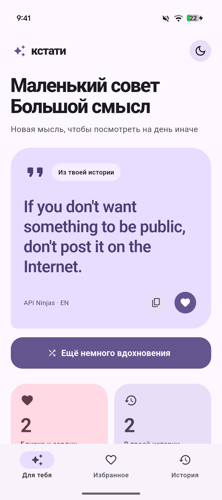
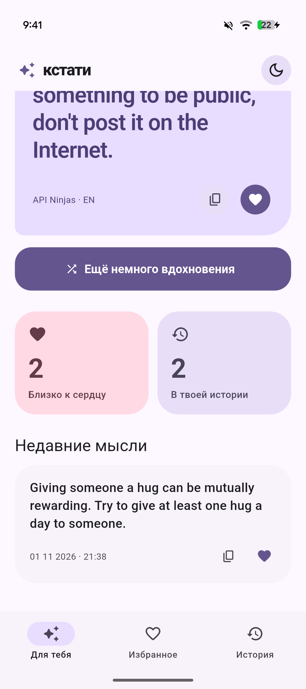
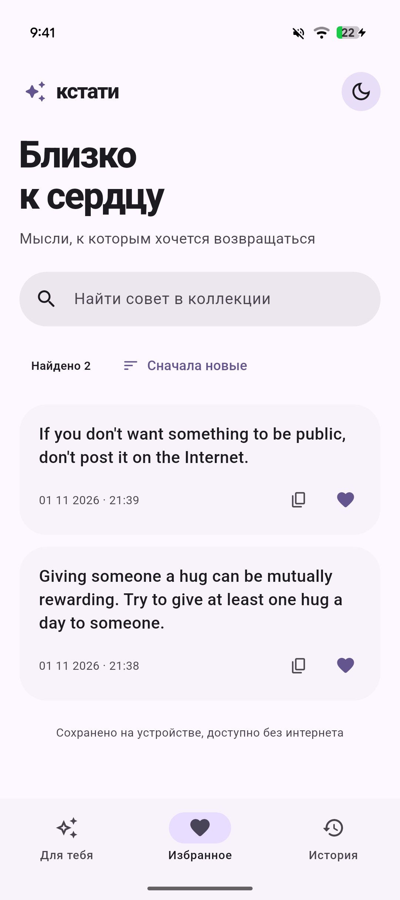
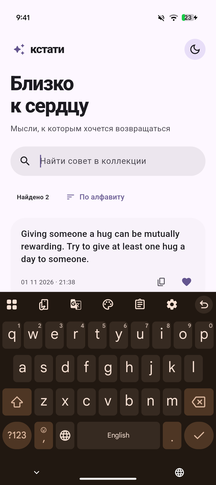
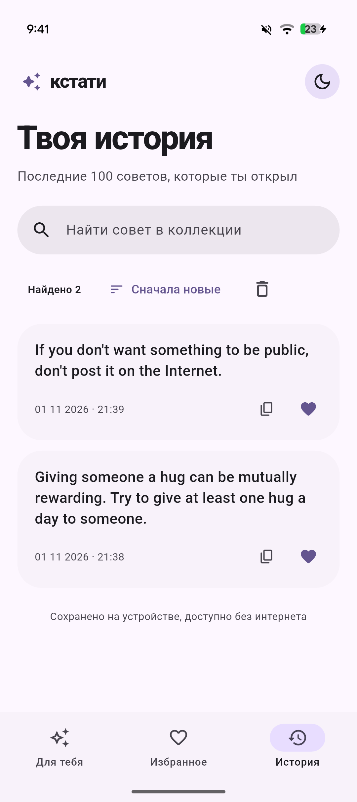
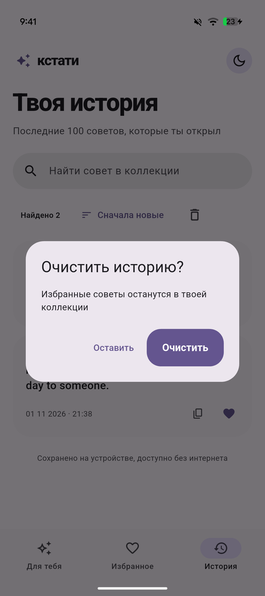
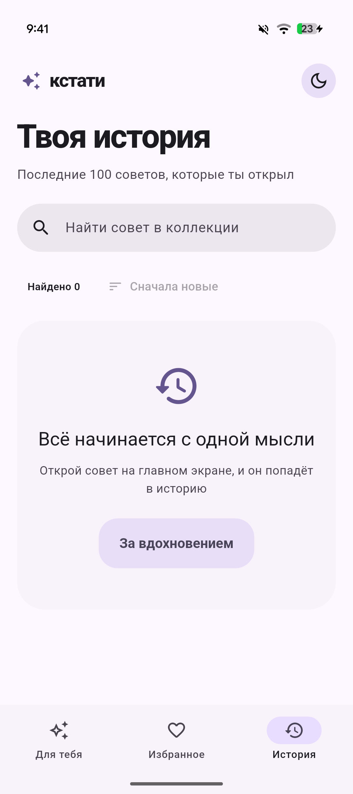
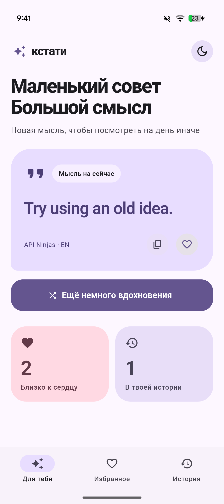
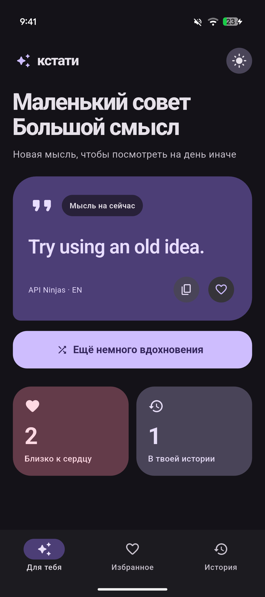

Практическая работа 3

Кстати это приложение с короткими советами
При первом открытии приложение получает совет от API Ninjas
Можно загрузить новый совет и скопировать его
Понравившиеся советы можно добавить в избранное
История и избранное сохраняются на телефоне и доступны без интернета
Есть поиск и сортировка
Историю можно очистить отдельно от избранного
Есть светлая и темная тема

Запросы выполняет Dio
Отдельный interceptor добавляет ключ в заголовок запроса
pretty_dio_logger выводит запросы и ответы при отладке
get_it хранит зависимости приложения
В main находится запуск приложения и регистрация зависимостей
Interceptor находится в отдельном файле
Сервис получает советы и обрабатывает ошибки
Интерфейс находится в отдельном файле экрана
Контроллер управляет загрузкой и коллекцией советов

А теперь скриншоты:

  

  

  
